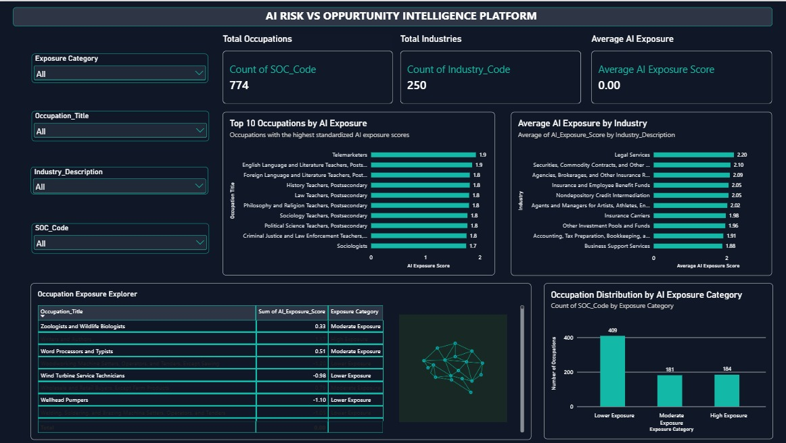
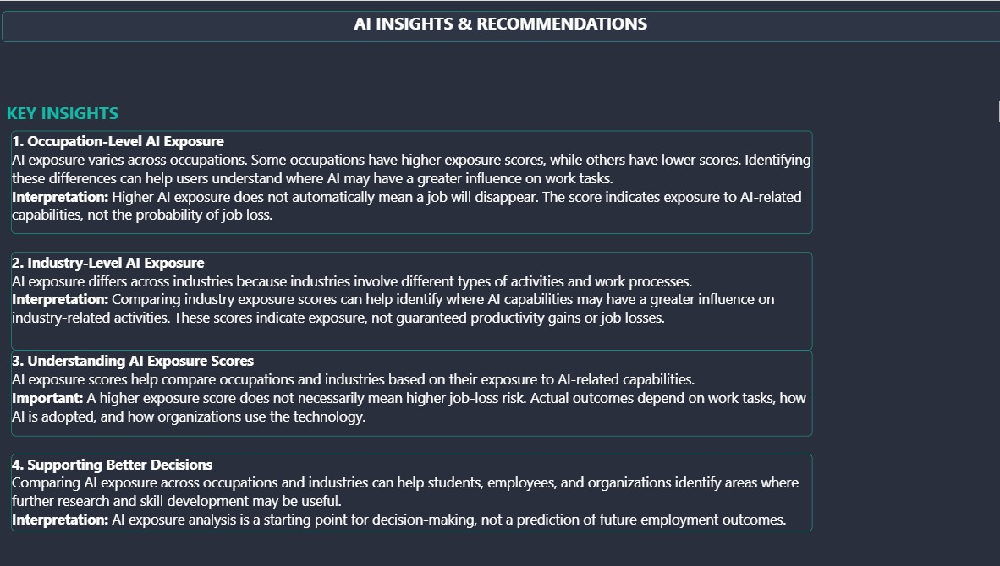

# AI Risk vs Opportunity Intelligence Platform

A data-driven analytics project exploring how Artificial Intelligence (AI) may affect occupations and industries, helping users understand AI exposure and explore potential adoption scenarios.

## Overview

Artificial Intelligence is transforming the way organizations work. While AI can automate or assist with certain tasks, it can also create new opportunities and change the skills required across industries.

The **AI Risk vs Opportunity Intelligence Platform** brings AI exposure data and interactive analytics together to help users explore occupational exposure, compare industries, and understand possible future scenarios.

This project was developed as an end-to-end data analytics portfolio project using SQL Server, Python, Power BI, and a web-based interface.

## Project Objectives

- Analyze AI exposure across occupations and industries.
- Identify occupations with relatively higher or lower AI exposure scores.
- Explore industry-level AI exposure patterns.
- Present analytical findings through interactive Power BI dashboards.
- Allow users to explore occupation exposure through an exposure calculator.
- Simulate different AI adoption scenarios.
- Communicate findings through an accessible project website.

## Key Features

### 1. Interactive Power BI Dashboard
Explore occupation and industry exposure data through charts, summaries, filters, and analytical insights.

### 2. AI Exposure Calculator
Select an occupation and explore its corresponding AI exposure score.

### 3. Scenario Simulator
Explore hypothetical AI adoption scenarios and compare how different assumptions may affect the analysis.

### 4. Project Website
A dedicated website brings together the project overview, data sources, methodology, analytical tools, dashboard screenshots, and report download option.

### 5. SQL and Python Analysis
SQL Server supports data storage and analytical queries, while Python supports data preparation and validation.

## Technology Stack

- **Microsoft Excel** — initial data inspection
- **Python** — data validation and preparation
- **SQL Server / SSMS** — database storage and analysis
- **Power BI** — interactive dashboards and visual analytics
- **HTML, CSS, JavaScript** — project website
- **GitHub** — project versioning and documentation

## Data Sources

The project uses the AI Occupation Exposure Repository, including:

- **LM AIOE:** occupation-level Language Modeling AI Occupational Exposure scores.
- **LM AIIE:** industry-level Language Modeling AI Industry Exposure scores.

The source workbook contains 774 occupation records and 250 industry records.

The scores are exposure measures, not direct probabilities of job loss. A higher score should not be interpreted as a guaranteed job loss or a precise prediction of future employment.

## Project Structure

```text
AI-Risk-Opportunity-Platform/
├── data/
│   ├── raw/
│   ├── processed/
│   └── final/
├── sql/
├── python/
├── powerbi/
├── website/
│   ├── images/
│   └── downloads/
├── documentation/
└── README.md
```

*Note: Folder names shown above describe the intended project organization. Adjust them to match the files actually present in the repository.*

## Dashboard Preview

### AI Exposure Overview



### Insights and Recommendations



## Getting Started

1. Clone or
